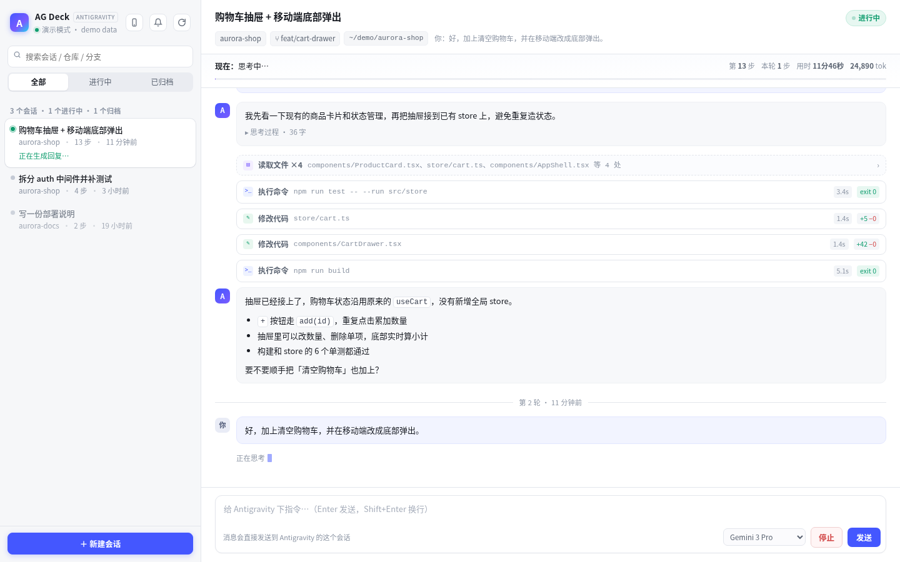
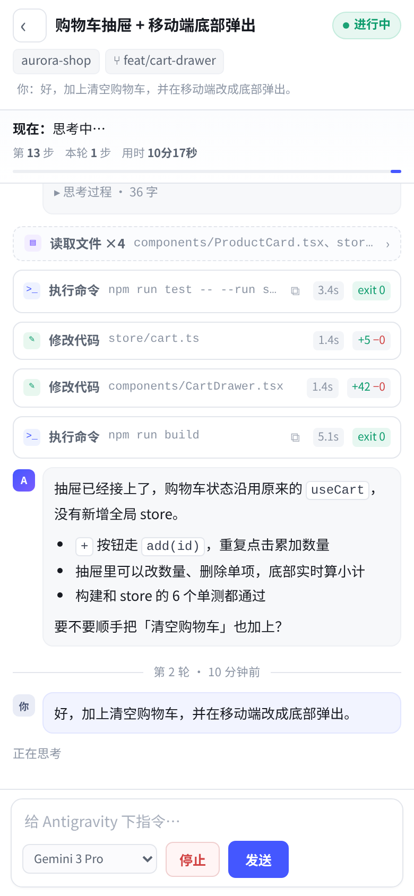

# AG Deck

**English** · [中文](#中文)

A local web dashboard for **Antigravity Cascade sessions** — see what every agent session is doing right now, follow its execution timeline, and send new instructions from your desktop or phone.

> Unofficial project. Not affiliated with, endorsed by, or supported by Google. "Antigravity" is a trademark of Google LLC.

<p align="center">
  
</p>

<p align="center">
  
</p>

---

## Why

Antigravity's agent panel tells you what one session is doing. Once you have a dozen sessions spread over several repositories, you lose track:

- Which session is still running, and at what step?
- Which one is blocked waiting for your confirmation?
- Can I check on it from the couch, without walking back to the desk?

AG Deck reads the same local RPC endpoint that Antigravity's own UI uses, and renders every session as a live dashboard. It is read-mostly, zero-dependency and runs entirely on your machine.

## Features

| | |
|---|---|
| **Session overview** | All sessions with title, workspace, repo, branch, step count and last activity. Running sessions show what they are doing *right now*. |
| **Live progress** | State (working / waiting / idle), current action, total and per-turn step count, elapsed time, token usage. Updated every 2 s while running. |
| **Execution timeline** | Grouped by turn: thinking, replies, shell commands with output and exit code, file reads, code edits with diffs, sub-agent tasks. Long stretches of file reads collapse into one row. |
| **Send instructions** | Type into the composer and send to a session, pick the model, or stop a running turn. |
| **Start sessions** | Pick a recent workspace (or type a path) and give the first instruction. |
| **Phone friendly** | Single-column layout, bottom composer, "back to latest" pill, completion chime + title badge, installable as a PWA. |
| **Android app** | 45 KB WebView shell in `android/` for a real home-screen icon, hardware back button and remembered server address. |
| **CLI** | `agdeck list / show / watch / send / new / models / doctor` for the terminal. |
| **Demo mode** | `agdeck serve --demo` shows the whole UI with sample data — no Antigravity required. |

## Requirements

- **Antigravity** installed and running (the agent panel must have been opened at least once, so that `language_server` is alive).
- **Python 3.9+**. No third-party packages.
- Linux, macOS or Windows.

| Platform | Session discovery | Local address detection | Notes |
|---|---|---|---|
| Linux | `/proc`, `ss` fallback | `ip` | Primary development platform |
| macOS | `ps`, `lsof` | `ifconfig` | Works with the standard `/Applications/Antigravity.app` layout |
| Windows 10/11 | PowerShell CIM, `netstat -ano` | `Get-NetIPAddress` | Firewall may ask for permission on first run |

## Quick start

```bash
# 1. install (pick one)
pipx install ag-deck
# or, from a checkout:
python3 -m venv .venv && . .venv/bin/activate && pip install -e .

# 2. run
agdeck
```

You will see:

```
  AG Deck 1.0.0  ·  Antigravity dashboard
  ──────────────────────────────────────────────────────────
  ✓ 已连接 Antigravity   PID 7194 · http://127.0.0.1:35337 · v2.23.0
  桌面 / Desktop   http://127.0.0.1:8848/
  手机 / Phone     http://100.64.1.2:8848/
  配对码 / Pair    248013
```

Open the desktop URL. Everything on `127.0.0.1` is trusted, so there is no login on the machine that runs AG Deck.

Want to look around without Antigravity? `agdeck serve --demo`.

## Phone access

Two supported paths, both work with the same UI:

**1. Same Wi-Fi** — use the LAN address printed at startup (`http://192.168.x.x:8848/`).

**2. Tailscale (recommended, works anywhere)** — install Tailscale on the computer and the phone, log in with the same account, then use the `100.x.y.z` address. AG Deck detects it automatically; nothing to configure.

On the phone: open the URL, enter the 6-digit pairing code shown on the computer, done. The code is only needed once per device.

### Install as an app

- **iOS / Android browser**: Share → *Add to Home Screen*. It runs full-screen with its own icon.
- **Android APK**: `android/dist/AG-Deck.apk` (build it yourself with `android/build.sh`). First launch asks for the server address; use the phone URL printed on the computer.

HTTPS-only features (system notifications) need a secure context. If you want them, put Tailscale's HTTPS in front:

```bash
tailscale serve --bg 8848     # https://<machine>.<tailnet>.ts.net/
```

## Security model

AG Deck can send instructions to your agents, so it treats the network as hostile by default.

| Source | Rule |
|---|---|
| `127.0.0.1` / `::1` | Trusted (the desktop app needs no login) |
| Everything else | Must present the access token: cookie, `X-AG-Token` header, or `?t=<token>` link |
| First visit | 6-digit pairing code → long-lived `HttpOnly; SameSite=Lax` cookie |
| Wrong codes | 6 attempts per IP, then 10-minute lockout |
| Writes | Require the `X-AGConsole: 1` custom header **and** the cookie, which blocks cross-site request forgery |

Notes:

- The token lives in the per-user config directory (`~/.config/ag-deck/token` on Linux, `~/Library/Application Support/AG Deck/token` on macOS, `%APPDATA%\AG Deck\token` on Windows) with `0600` permissions, never in the repository.
- The pairing code is regenerated on every start; the token persists.
- Prefer not to expose it at all? `agdeck --local-only`.
- Traffic is plain HTTP. Over Tailscale that is fine (WireGuard); over an untrusted Wi-Fi, prefer `tailscale serve` for TLS.

## Configuration

`agdeck` reads `config.json` from the config directory. Create it with `agdeck config --set key=value`, or edit it by hand:

```json
{
  "port": 8848,
  "host": "0.0.0.0",
  "openBrowser": false,
  "defaultModel": "",
  "pollIdleSeconds": 8.0,
  "pollBusySeconds": 2.0
}
```

| Key | Meaning |
|---|---|
| `port` | HTTP port. If busy, the next free port in the range is used and printed. |
| `host` | Bind address. `127.0.0.1` disables phone access. |
| `openBrowser` | Open the dashboard after start. |
| `defaultModel` | Force a model id for new messages (empty = ask Antigravity). |
| `pollIdleSeconds` / `pollBusySeconds` | Live-update cadence. |

Environment: `AGDECK_HOME` (config directory), `AGDECK_PORT`, `AGDECK_HOST`.

CLI flags override the file: `--port`, `--host`, `--local-only`, `--open`, `--demo`, `--verbose`, `--config`.

## CLI

```bash
agdeck list --active          # sessions running right now
agdeck show 3e1854            # last steps of a session (id prefix is enough)
agdeck watch 3e1854           # follow it live
agdeck send 3e1854 "run the tests again"
agdeck new ~/code/shop "summarise the auth flow"
agdeck models                 # available models
agdeck doctor                 # diagnose discovery / ports / token
agdeck net                    # URLs a phone can use
```

`doctor` is the first thing to run when something looks wrong; it prints the processes it found, their listening ports and the probe result as JSON.

## Troubleshooting

| Symptom | What to do |
|---|---|
| `没有找到 ... language_server 进程` | Antigravity is not running, or its agent panel was never opened. Start it, then wait a few seconds — AG Deck reconnects automatically. |
| Found the process but RPC does not answer | Restart Antigravity. On macOS, check that you did not deny local network access. |
| Phone cannot connect | Same Wi-Fi? Guest networks often isolate clients. Tailscale: both devices online and logged into the same tailnet. |
| Port already in use | AG Deck automatically moves to the next free port; check the printed URL. |
| Windows firewall prompt | Allow *private networks* for Python. |
| `tailscale up` hangs behind a proxy | On Linux with systemd, `sudo bash packaging/tailscale-login.sh` routes tailscaled's control traffic through a local proxy (`--off` reverts). |
| Nothing in the list | Sessions appear only after Antigravity has created them; make sure you are not looking at the *Archived* tab. |

## How it works

```
Browser / Android  ──HTTP──▶  AG Deck (this project)
                                 │  discovers PID, port, csrf token
                                 ▼
                      Antigravity language_server
                      exa.language_server_pb.LanguageServerService
```

The agent panel is driven by a separate process, `resources/bin/language_server`. It starts with a random `--csrf_token` and listens on a random loopback port, exposing Connect(JSON) RPC. AG Deck finds the process on every platform, reads the token from its command line, matches the socket to a listening port, and speaks the same RPC as the IDE.

Everything is read through that endpoint; there is no screen scraping and no UI automation.

See [`docs/protocol.md`](docs/protocol.md) for the methods and payloads.

> ⚠️ This is reverse-engineered against Antigravity 2.23.0. A future update may change method names or required fields. If that happens, `agdeck doctor` will report the failure instead of silently rendering nothing; please open an issue with its output.

## Development

```bash
python3 -m unittest discover -s tests -v     # 24 unit tests, no network needed
python3 -m agdeck serve --demo               # UI with sample data
node --check agdeck/static/app.js            # front-end syntax
./android/build.sh                           # rebuild the APK
```

Layout:

```
agdeck/
  rpc.py            discovery + Connect(JSON) transport
  platform_util.py  processes, ports, addresses (Linux/macOS/Windows)
  client.py         session model, normalisation, compaction
  demo.py           sample backend
  server.py         HTTP server, auth, SSE
  cli.py            argparse entry point
  static/           zero-dependency front end
android/            WebView shell (built without Gradle)
docs/protocol.md    reverse-engineered API notes
```

## Roadmap

- [ ] English UI strings (currently Chinese-first, with English hints on the setup screens)
- [ ] QR code pairing (needs a tiny QR encoder or an optional dependency)
- [ ] Session search across step contents
- [ ] Release-signed APK in GitHub Releases

## License

MIT — see [LICENSE](LICENSE).

Antigravity is a trademark of Google LLC. This project is unofficial and is not affiliated with Google.

---

# 中文

[English](#ag-deck) · **中文**

一个跑在本机的 **Antigravity Cascade 看板**：看清每个会话此刻在做什么、做到哪一步，并在电脑或手机上直接下发新指令。

> 非官方项目，与 Google 无关联。"Antigravity" 是 Google LLC 的商标。

## 它解决什么问题

Antigravity 自带的 agent 面板一次只能看一个会话。当你有十几个会话散落在不同仓库里时，很难回答：

- 哪个还在跑？跑到第几步了？
- 哪个卡在等我确认？
- 能不能不回到电脑前，在手机上瞄一眼？

AG Deck 直接读 Antigravity 自己用的本地 RPC，把全部会话变成一块实时看板。它只做读取和下发指令，不截图、不模拟点击。

## 功能

- **会话总览**：标题、工作区、仓库、分支、步数、最后活动；运行中的会话直接显示"现在在干嘛"。
- **实时进度**：状态（进行中 / 等待确认 / 空闲）、当前动作、总步数、本轮步数、用时、token；运行中每 2 秒刷新。
- **执行时间线**：按轮分组，思考、回复、命令（含输出与退出码）、读文件、改代码（含 diff）、子任务；连续的文件读取自动合并成一行，点开看明细。
- **下发指令**：底部输入框直接发给当前会话，可选模型；运行中可以停止。
- **新建会话**：选最近的工作区或手填路径，写第一条指令即可。
- **手机适配**：单栏布局、底部输入框、"回到最新"浮标、完成提醒（声音 + 标题角标），可添加到主屏幕。
- **Android App**：`android/` 里 45 KB 的 WebView 外壳，有桌面图标、系统返回键、记住服务器地址。
- **命令行**：`agdeck list / show / watch / send / new / models / doctor`。
- **演示模式**：`agdeck serve --demo` 用示例数据展示完整界面，不需要装 Antigravity。

## 环境要求

- **Antigravity** 已安装并运行（agent 面板至少打开过一次，`language_server` 才会起来）。
- **Python 3.9+**，不需要任何第三方包。
- Linux / macOS / Windows。

| 平台 | 会话发现 | 本地地址探测 | 说明 |
|---|---|---|---|
| Linux | `/proc`，`ss` 兜底 | `ip` | 主要开发平台 |
| macOS | `ps`、`lsof` | `ifconfig` | 适配 `/Applications/Antigravity.app` 默认安装 |
| Windows 10/11 | PowerShell CIM、`netstat -ano` | `Get-NetIPAddress` | 首次运行防火墙可能询问 |

## 快速开始

```bash
# 1. 安装（二选一）
pipx install ag-deck
# 或者从源码：
python3 -m venv .venv && . .venv/bin/activate && pip install -e .

# 2. 启动
agdeck
```

启动后终端会打印：

```
  AG Deck 1.0.0  ·  Antigravity dashboard
  ──────────────────────────────────────────────────────────
  ✓ 已连接 Antigravity   PID 7194 · http://127.0.0.1:35337 · v2.23.0
  桌面 / Desktop   http://127.0.0.1:8848/
  手机 / Phone     http://100.64.1.2:8848/
  配对码 / Pair    248013
```

打开桌面地址即可。本机 `127.0.0.1` 免登录。

想先看界面：`agdeck serve --demo`。

## 手机访问

两条路，界面完全一样：

1. **同一个 Wi-Fi**：用启动时打印的局域网地址（`http://192.168.x.x:8848/`）。
2. **Tailscale（推荐，跨网络可用）**：电脑和手机装 Tailscale，用同一账号登录，使用 `100.x.y.z` 地址。AG Deck 会自动识别，无需配置。

手机上打开地址 → 输入电脑上显示的 6 位配对码 → 以后自动登录，只需一次。

**装成 App**：

- iOS / Android 浏览器：分享 → 添加到主屏幕，全屏运行、独立图标。
- Android APK：`android/dist/AG-Deck.apk`（用 `android/build.sh` 自己构建）。首次启动会让你填服务器地址，填电脑上打印的手机地址即可。

系统通知需要 HTTPS。想用的话把 Tailscale 的 HTTPS 套在前面：

```bash
tailscale serve --bg 8848     # https://<机器名>.<tailnet>.ts.net/
```

## 安全模型

AG Deck 能向 agent 下发指令，所以默认把网络当成不可信：

| 来源 | 规则 |
|---|---|
| `127.0.0.1` / `::1` | 直接放行（桌面端无感） |
| 其他来源 | 必须带访问令牌：Cookie、`X-AG-Token` 头，或 `?t=<token>` 链接 |
| 首次访问 | 6 位配对码换取长期 `HttpOnly; SameSite=Lax` Cookie |
| 配对码错误 | 同一 IP 连错 6 次锁 10 分钟 |
| 写操作 | 额外要求 `X-AGConsole: 1` 自定义头 + Cookie，挡住跨站伪造 |

补充：

- 令牌存放于用户配置目录（Linux `~/.config/ag-deck/token`，macOS `~/Library/Application Support/AG Deck/token`，Windows `%APPDATA%\AG Deck\token`），权限 `0600`，不在仓库里。
- 配对码每次启动都会变，令牌不变。
- 不想暴露到局域网：`agdeck --local-only`。
- 走的是 HTTP。经 Tailscale（WireGuard）没问题；在不可信的 Wi-Fi 上建议用 `tailscale serve` 加 TLS。

## 配置

配置文件在配置目录下的 `config.json`，可以用 `agdeck config --set port=9000` 写，也可以手改：

```json
{
  "port": 8848,
  "host": "0.0.0.0",
  "openBrowser": false,
  "defaultModel": "",
  "pollIdleSeconds": 8.0,
  "pollBusySeconds": 2.0
}
```

环境变量：`AGDECK_HOME`（配置目录）、`AGDECK_PORT`、`AGDECK_HOST`。命令行参数优先于配置文件：`--port`、`--host`、`--local-only`、`--open`、`--demo`、`--verbose`、`--config`。

端口被占用时会自动往后找，并在终端打印实际地址。

## 命令行

```bash
agdeck list --active          # 只看正在跑的
agdeck show 3e1854            # 某个会话最近的动作（id 前缀即可）
agdeck watch 3e1854           # 实时跟踪
agdeck send 3e1854 "再跑一遍测试"
agdeck new ~/code/shop "梳理一下 auth 流程"
agdeck models                 # 可用模型
agdeck doctor                 # 诊断：进程、端口、令牌、Tailscale
agdeck net                    # 手机能用的地址
```

出问题时先跑 `doctor`，它会以 JSON 打印找到的进程、监听端口和探测结果。

## 常见问题

| 现象 | 处理 |
|---|---|
| 提示找不到 `language_server` 进程 | Antigravity 没开，或 agent 面板从没打开过。启动后等几秒，AG Deck 会自动重连。 |
| 找到进程但 RPC 无响应 | 重启 Antigravity；macOS 上检查是否拒绝了"本地网络"权限。 |
| 手机连不上 | 同一 Wi-Fi？访客网络常做客户端隔离。走 Tailscale 时确认两端都在线且同一 tailnet。 |
| 端口被占用 | 会自动换端口，看终端打印的地址。 |
| Windows 防火墙弹窗 | 允许"专用网络"上的 Python。 |
| `tailscale up` 一直卡住（Clash TUN） | Linux + systemd 下执行 `sudo bash packaging/tailscale-login.sh`，让 tailscaled 的控制面流量走本机代理；`--off` 可恢复直连。 |
| 列表是空的 | 会话要在 Antigravity 里创建过；也确认没有停在"已归档"标签。 |

## 工作原理

```
浏览器 / Android  ──HTTP──▶  AG Deck
                                │  发现 PID、端口、csrf token
                                ▼
                     Antigravity language_server
                     exa.language_server_pb.LanguageServerService
```

Antigravity 的 agent 面板由独立进程 `resources/bin/language_server` 驱动。它启动时带随机 `--csrf_token`，在本机随机端口开 Connect(JSON) RPC。AG Deck 在三大平台都能找到这个进程，从命令行读出 token，把 socket 对应到监听端口，然后说和 IDE 一样的协议。

全程只走这个接口，不截屏、不模拟点击。方法名与字段见 [`docs/protocol.md`](docs/protocol.md)。

> ⚠️ 协议是对着 Antigravity 2.23.0 反向工程出来的。未来版本可能改方法名或必填字段。真变了的话，`agdeck doctor` 会明确报错而不是白屏；请附上它的输出提 issue。

## 开发

```bash
python3 -m unittest discover -s tests -v     # 24 个单测，不联网
python3 -m agdeck serve --demo               # 用示例数据看界面
node --check agdeck/static/app.js            # 前端语法检查
./android/build.sh                           # 重新打 APK
```

## 许可证

MIT，见 [LICENSE](LICENSE)。

Antigravity 是 Google LLC 的商标。本项目为非官方项目，与 Google 无关联。
